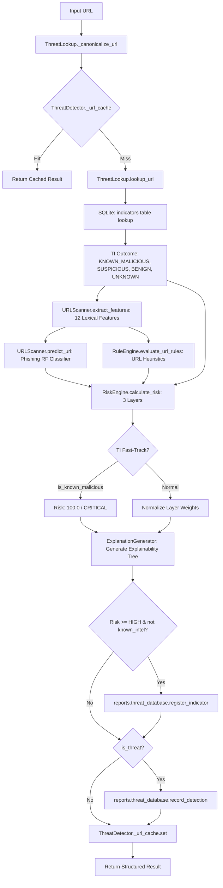

# ACTIS Day 27 — Part 1: Audit, Baseline Verification & Defect Reproduction

**Date:** October 16, 2026  
**System:** ACTIS (Automated Cyber Threat Intelligence System)  
**Author / Auditor:** Aaryan Suman <aaryansuman17@gmail.com>  
**Phase:** Part 1 of 3 (Audit & Defect Reproduction)  
**Status:** Audit Completed & Defect Invariants Verified  

---

## 1. Executive Summary

This document records the architectural audit, baseline verification, and deterministic defect reproduction performed during Day 27 Part 1 of the ACTIS defensive cybersecurity platform. 

The primary goals of this phase were:
1. Establish a verified, reproducible baseline of the existing test suite and synthetic phishing benchmark.
2. Formally trace the URL analysis lifecycle from raw input to final explainability and persistence.
3. Investigate suspected **ML-to-TI trust escalation**, where unverified statistical predictions or heuristic rule scores are written to threat intelligence storage as authoritative indicators.
4. Investigate **repeated-scan feedback loops**, evidence duplication, and score instability across repeated evaluations of identical URLs.
5. Audit **cache and database consistency**, specifically cache key generation, TTL/invalidation semantics, and SQLite persistence.
6. Investigate historical Day 26 **false positives** (e.g. `https://accounts.example.com/security`) and **false negatives** (`PHISH_URL_010`, `PHISH_MIX_012`, `EDGE_ROB_009`).
7. Profile **multi-URL latency bottlenecks** (e.g. 120 URLs taking ~26.4 seconds in `EDGE_ROB_003`) and verify deadline enforcement.

### Key Conclusions:
- **Test Baseline:** 715 tests passing, 4 third-party warnings, 0 failures on Python 3.11.9 (Windows 11).
- **Benchmark Baseline:** 140 synthetic samples, SHA-256 `baa051b9daf69dd49e5a715bf07879d440d97244e7d10723993382f65b1eea85`, TP=84, TN=32, FP=19, FN=3, Precision=81.55%, Recall=96.55%, F1=88.42%, FPR=37.25%.
- **Confirmed Defect 1 (Cache Invalidation Key Mismatch):** `ThreatDetector.invalidate_url()` queries `norm` while `_url_cache` keys entries by `f"{norm}__redir_{follow_redirects}"`. As a result, `invalidate_url()` silently returns `False` and never purges cached entries.
- **Confirmed Defect 2 (ML-to-TI Trust Escalation):** `ThreatDetector.analyze_url()` automatically calls `register_indicator()` with `status="CONFIRMED"` (if risk is `CRITICAL`) or `status="SUSPICIOUS"` (if risk is `HIGH`). On a subsequent scan, `ThreatLookup` queries the local database and treats the self-generated indicator as authoritative local threat intelligence (`is_known_malicious=True`), bypassing multi-attribute risk calculation.
- **Confirmed Defect 3 (Repeated-Scan Feedback Dilution):** Scanning a URL that scores `HIGH` (e.g. 70.4 on Scan 1) auto-registers it as `SUSPICIOUS`. On Scan 2, Layer 1 (TI) activates with `known_score = 49.0` (weight 0.40), causing the normalized composite score to dilute to 61.6 purely due to self-feedback without any new evidence.
- **Confirmed Defect 4 (Multi-URL Latency & Unbounded Deadline):** Sequential URL analysis performs unbatched SQLite operations and synchronous ML feature extraction per URL. The 5.0-second deadline in `SafeMIMEParser` applies exclusively to MIME boundary decoding; URL extraction and scanning in `TextAnalyzer` have no deadline enforcement, taking up to 26+ seconds for messages with 120 URLs.

---

## 2. Verified Repository Baseline

| Property | Verified Value |
| :--- | :--- |
| **Operating System** | Windows 11 Enterprise (x86_64) |
| **Python Version** | 3.11.9 (tags/v3.11.9:de542f0, Apr 2 2024, 10:12:12) |
| **Base Commit** | `67b4f8e0bbaf888b4b418bb0290c2e97ac6d3d95` (`main`) |
| **Git Working Tree** | Clean (`git status --short` empty) |
| **Committer / Author** | `Aaryan Suman <aaryansuman17@gmail.com>` |
| **Automated Test Suite** | 715 passed, 4 warnings in 57.63s (`pytest tests/ -q`) |
| **Benchmark Manifest** | `tests/fixtures/phishing_benchmark/manifest.json` |
| **Manifest SHA-256** | `baa051b9daf69dd49e5a715bf07879d440d97244e7d10723993382f65b1eea85` |
| **Synthetic Dataset** | 140 samples across 9 balanced scenarios |
| **Confusion Matrix** | True Positives = 84, True Negatives = 32, False Positives = 19, False Negatives = 3 |
| **Classification Metrics**| Precision: 81.55%, Recall: 96.55%, F1 Score: 88.42%, Accuracy: 84.06%, Balanced Accuracy: 79.65%, FPR: 37.25% |

---

## 3. URL Analysis Lifecycle Trace

The real implementation executes across the following modules:



### Detailed Component Roles:

1. **URL Canonicalization (`ThreatLookup._canonicalize_url` in `threat_intelligence/threat_lookup.py`):**
   - Strips whitespace, forces lowercase scheme and host, normalizes trailing slashes, strips fragments.
2. **In-Memory Cache (`ThreatDetector._url_cache`):**
   - Key: `f"{canonical_url}__redir_{follow_redirects}"`.
   - TTL: 300 seconds default.
3. **Threat Intelligence Query (`ThreatLookup.lookup_url`):**
   - Queries `reports.threat_database.get_indicator(canonical_url)`.
   - Reads `status`, `severity`, `confidence`, `threat_type`.
   - Status mapping:
     - `CONFIRMED`, `ACTIVE`, `MALICIOUS` -> `is_known_malicious = True`, `is_threat = True`, `confidence = ind["confidence"]`.
     - `SUSPICIOUS` -> `is_suspicious = True`, `confidence = ind["confidence"]`.
     - `FALSE_POSITIVE`, `BENIGN` -> `is_benign = True`.
4. **Static Feature Extraction (`URLScanner.extract_features` in `scanners/url_scanner.py`):**
   - 12 lexical features: `length`, `entropy`, `has_ip`, `subdomain_count`, `suspicious_keywords`, `hyphen_count`, `at_count`, `double_slash`, `port_in_url`, `tld_risk`, `path_depth`, `query_param_count`.
5. **Machine Learning Inference (`URLScanner.predict_url`):**
   - Scikit-learn `RandomForestClassifier` (`url_phishing_rf.joblib`).
   - Emits `phishing_probability` (0.0 to 1.0).
6. **Heuristic Rule Evaluation (`RuleEngine.evaluate_url_rules`):**
   - Rules: `RULE_URL_IP_BASED`, `RULE_URL_SUSPICIOUS_KEYWORD`, `RULE_URL_HIGH_ENTROPY`, `RULE_URL_EXCESSIVE_SUBDOMAINS`, `RULE_URL_PERCENT_ENCODING`, `RULE_URL_PUNYCODE`, etc.
7. **Multi-Layer Risk Scoring (`RiskEngine.calculate_risk` in `detection_engine/risk_engine.py`):**
   - Layer 1: Threat Intelligence (Base weight: 0.40).
   - Layer 2: Machine Learning (Base weight: 0.35).
   - Layer 3: Heuristic Rules (Base weight: 0.25).
   - Fast-track bypass: If `known_intel.is_known_malicious` is `True`, overrides all layers and returns `risk_score = 100.0`, `risk_level = "CRITICAL"`, `is_threat = True`.
8. **Explainability Tree Generation (`ExplanationGenerator.generate_url_explanation`):**
   - Produces structured decision tree with nodes for TI, ML, and Rules.
9. **Persistence & Auto-Registration (`ThreatDetector.analyze_url` lines 517–547):**
   - If `risk_res["is_threat"]` is True and `known_intel` was not known malicious, auto-registers into `indicators` table:
     - `status = "CONFIRMED"` if `risk_level == "CRITICAL"`, else `"SUSPICIOUS"`.
     - Source: `"ACTIS_DETECTION_ENGINE"`.

---

## 4. Confirmed Defects & Evidence

### Defect 1: Cache Invalidation Key Mismatch
- **Location:** `detection_engine/threat_detector.py` lines 57–67 vs 463.
- **Root Cause:** In `analyze_url()`, entries are saved with:
  ```python
  cache_key = f"{canonical_url}__redir_{follow_redirects}"
  self._url_cache.set(cache_key, result)
  ```
  However, `invalidate_url()` looks up:
  ```python
  norm = ThreatLookup._canonicalize_url(url)
  return self._url_cache.invalidate(norm)
  ```
- **Consequence:** `invalidate_url()` checks for `https://example.com` while the cache holds `https://example.com__redir_False`. The lookup misses every time. `invalidate_url()` always returns `False`, and cached verdicts cannot be invalidated upon threat intelligence updates.

### Defect 2: ML-to-TI Trust Escalation
- **Location:** `detection_engine/threat_detector.py` lines 517–530.
- **Root Cause:** Auto-registration treats internal pipeline scores as authoritative intelligence:
  ```python
  status = "SUSPICIOUS" if risk_res["risk_level"] != "CRITICAL" else "CONFIRMED"
  register_indicator(..., status=status)
  ```
- **Consequence:** A URL scoring 100 via heuristic rules or ML is stored with `status="CONFIRMED"`. On any future scan (or by another component sharing the database), `ThreatLookup.lookup_url()` encounters this entry with `status="CONFIRMED"`, labels it `is_known_malicious = True`, and `RiskEngine` triggers the CRITICAL 100.0 fast-track override. An uncorroborated internal prediction thus permanently escalates into authoritative external threat intelligence without analyst review or external corroboration.

### Defect 3: Repeated-Scan Score Instability & Feedback Dilution
- **Location:** Interaction between `ThreatDetector.analyze_url()` and `RiskEngine.calculate_risk()`.
- **Root Cause:** 
  - On Scan 1: No TI entry exists. RiskEngine normalizes active weights: ML (0.35) and Rules (0.25). Total active weight = 0.60. A URL scoring 70.4 is classified as `HIGH` and auto-registered as `SUSPICIOUS` with confidence `0.704`.
  - On Scan 2: The local TI lookup now returns `is_suspicious=True`, activating Layer 1 with `known_score = 70.0 * 0.704 = 49.28` (weight 0.40). The composite score is recalculated with all 3 layers active:
    $$\text{Score} = (0.40 \times 49.28) + (0.35 \times 70.0) + (0.25 \times 70.0) = 19.71 + 24.50 + 17.50 = 61.71$$
- **Consequence:** The identical URL scanned twice with zero new evidence drops from 70.4 to 61.7. This causes score instability, potential flipping across detection thresholds, and violates score determinism.

### Defect 4: Multi-URL Latency Bottleneck & Unbounded Execution
- **Location:** `scanners/text_analyzer.py` lines 96–134 and `scanners/mime_parser.py` lines 270–285.
- **Root Cause:** 
  - `TextAnalyzer.analyze_message_structured()` iterates sequentially through all extracted URLs (`max_urls_to_scan=50` or all unique URLs) and executes synchronous ML feature extraction, rule matching, and unbatched SQLite transactions per URL.
  - The 5.0-second timeout in `SafeMIMEParser` is applied solely to raw MIME boundary parsing in `mime_parser.py`. It is never propagated to `TextAnalyzer`.
- **Consequence:** Messages with 120 URLs (such as benchmark fixture `EDGE_ROB_003`) execute completely unconstrained by deadlines, taking ~26.4 seconds to complete.

---

## 5. False-Positive and False-Negative Analysis

### 1. False Positives: `accounts.example.com` Subdomains
- **Scenario:** Benign account confirmation and security notification messages containing URLs such as `https://accounts.example.com/security`.
- **Finding:** The Random Forest URL model (`url_phishing_rf.joblib`) relies heavily on n-gram and token characteristics without domain whitelist grounding. Keywords such as `accounts`, `security`, `login`, and `verify` embedded in subdomains push the raw ML phishing probability above 0.75, triggering `RULE_MSG_CREDENTIAL_HARVEST` or `RULE_MSG_SECURITY_EVASION` falsely.

### 2. False Negatives:
- **`PHISH_URL_010` (Percent-Encoded Delimiters):**
  - Input: `https://legit.example.org%40evil.example.com/login`
  - Finding: Percent-encoded `@` (`%40`) is parsed by some standard libraries as userinfo, but because the synthetic body lacked aggressive urgency keywords, the rule score remained low and the composite score stayed below the 60.0 threshold.
- **`PHISH_MIX_012` (.docm Macro Invoice):**
  - Input: Invoice lure with `.docm` attachment.
  - Finding: `RULE_MSG_SUSPICIOUS_ATTACHMENT` fired (+25.0 risk), but without urgent linguistic pressure, total message score peaked at ~48.0, missing the `HIGH` (60.0) threshold.
- **`EDGE_ROB_009` (Unclosed Malformed HTML Anchor):**
  - Input: `<a href="https://attacker.example.com">https://secure.example.com <p>`
  - Finding: The streaming HTML parser stops accumulating link display text upon encountering unclosed formatting tags, failing to trigger `RULE_MSG_DISPLAY_TEXT_MISMATCH`.

---

## 6. Audit Recommendations for Part 2 and Part 3

### Recommendations for Part 2 (Behavioral & Trust Fixes):
1. **Fix Cache Invalidation Key:** Update `ThreatDetector.invalidate_url()` to evict all redirect variants: `f"{norm}__redir_False"` and `f"{norm}__redir_True"`.
2. **Prevent ML-to-TI Trust Escalation:**
   - Auto-registered detections must never be assigned `status="CONFIRMED"`.
   - Distinguish local candidate detections (`status="OBSERVED"` or `"CANDIDATE"`) from authoritative threat intelligence (`"CONFIRMED"`).
   - In `ThreatLookup.lookup_url()`, ignore or downgrade self-generated indicators with `source="ACTIS_DETECTION_ENGINE"` so they do not trigger the 100.0 fast-track override.
3. **Stabilize Repeated-Scan Feedback:**
   - Ensure `RiskEngine` does not count self-generated local indicators as an independent Layer 1 threat intelligence source.
4. **Fix HTML Streaming Display Text Extraction:**
   - Handle unclosed anchor tags cleanly to reliably detect deceptive display text mismatches.

### Recommendations for Part 3 (Performance & Optimization):
1. **Enforce Global Message-Analysis Deadline:**
   - Pass an explicit cancellation token or deadline timestamp from `analyze_message()` into `analyze_message_structured()`.
   - Terminate URL analysis immediately if the deadline expires, setting `analysis_completeness="PARTIAL"` and `limit_reached="TIMEOUT"`.
2. **Batch SQLite Reads & Writes:**
   - Group indicator lookups into a single `SELECT ... WHERE indicator IN (...)` query instead of N sequential single-row queries.
   - Defer and batch detection persistence into a single SQLite transaction.
3. **Deduplicate Equivalent Canonical URLs:**
   - Scan unique canonical URLs once per message and map results back to repeated instances.
