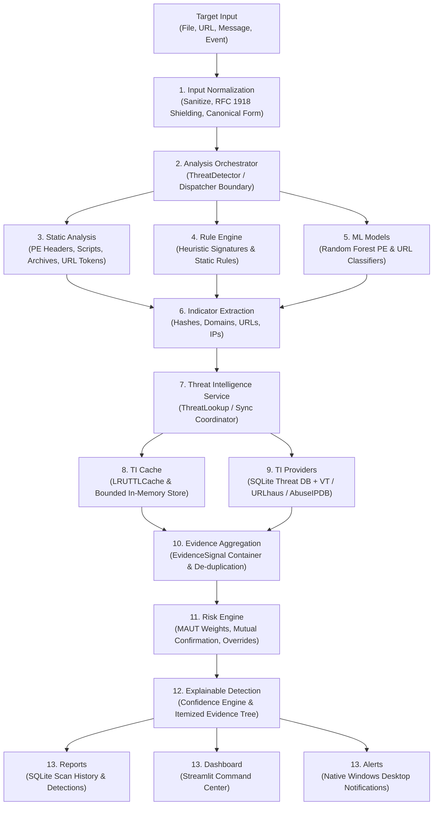

# ACTIS Detection Workflow & Target Detection Pipeline Architecture

**Authoritative Architecture Document**  
**Milestone:** Month 2, Week 6 (Day 21 / Day 22 Architectural Alignment)  
**Status:** Approved Target Architecture  
**Author:** Aaryan Suman <aaryansuman17@gmail.com>  

---

## 1. Executive Summary & Purpose

The **ACTIS Detection Engine** represents the core analytical intelligence layer of the Automated Cyber Threat Intelligence System. Positioned between raw event sources/scanners and reporting/alerting interfaces, the engine unifies heterogeneous signals across:

1. **Static Analysis & Feature Extraction:** PE binary parsing, Mandiant import hashing (`imphash`), section entropy, and non-PE streaming archive/script inspection.
2. **Deterministic Heuristic Rules:** PE threat API sequences, packaging anomalies, decompression bombs, script download cradles, and obfuscated invocations.
3. **Statistical Machine Learning (ML):** Supervised Random Forest classifiers for Windows PE malware and phishing URLs.
4. **Threat Intelligence (TI) & Multi-Provider Reputation:** Local SQLite reputation database, in-memory bounded LRU caching, and external threat feeds (VirusTotal v3, URLhaus, AbuseIPDB, and Central ACTIS backend).

Rather than relying on any single fragile analytical modality, ACTIS employs Multi-Attribute Utility Theory (MAUT) with dynamic weight re-normalization, mutual confirmation escalation, deterministic classification boundaries, and grounded explainability trees.

---

## 2. Complete Target Detection Pipeline Architecture

The authoritative detection pipeline routes incoming security targets through thirteen cohesive, decoupled stages:

```text
File / URL / Message
    |
    v
1. Input Normalization
    |
    v
2. Analysis Orchestrator
    |
    +-------------------+-------------------+
    |                   |                   |
    v                   v                   v
3. Static Analysis  4. Rule Engine     5. ML Models
    |                   |                   |
    +-------------------+-------------------+
                        |
                        v
              6. Indicator Extraction
                        |
                        v
             7. Threat Intelligence Service
                        |
                   +----+----+
                   |         |
                   v         v
             8. TI Cache   9. TI Providers (Local + External)
                   |         |
                   +----+----+
                        |
                        v
             10. Evidence Aggregation
                        |
                        v
                 11. Risk Engine
                        |
                        v
             12. Explainable Detection
                        |
             +----------+----------+
             |          |          |
             v          v          v
        13. Reports  Dashboard   Alerts
```

### 2.1 Formal Stage Flow Diagram (Mermaid)



---

## 3. Detailed Component Specifications (13 Pipeline Stages)

### Stage 1: Input Normalization & URL De-obfuscation
- **Purpose:** Sanitizes raw, unvalidated input targets from the filesystem, CLI, API, or message text. Enforces privacy boundaries (RFC 1918 / loopback shielding), performs standards-aware URL normalization, de-obfuscation (zero-width characters, IDN homoglyphs, numeric IP representations, userinfo tricks, double percent-encoding), and bounded safe redirect chain analysis with strict SSRF pre-validation.
- **Inputs:** Raw filesystem path (`Path` or `str`), raw URL string, or raw text message.
- **Outputs:** Canonical path, `URLAnalysisResult` (preserving both original and normalized URLs, parsed host/scheme/port, encoding findings, Unicode observations, validated redirect hops), public IP address, or sanitized message body.
- **Dependencies:** `urllib.parse`, `ipaddress`, `scanners/url_scanner.py`, `scanners/redirect_inspector.py`, `threat_intelligence/indicator_validator.py`, `scanners/file_watcher.py`.
- **Error Behavior:** Malformed inputs return structured validation errors (`is_valid=False`) with specific error messages; private IPs return privacy boundary shielding notices; redirect failures (loops, hop limits, deadlines, timeouts, SSRF blocks) are explicitly recorded without failing open.
- **Status:** **IMPLEMENTED AND VERIFIED** (Verified across `tests/test_url_scanner.py`, `tests/test_url_deobfuscation_and_redirects.py`, `tests/test_adversarial_security.py`, `tests/test_privacy_safeguards.py`).

### Stage 2: Analysis Orchestrator
- **Purpose:** Coordinates multi-stage evaluation across static analysis, rules, ML inference, and threat intelligence. Manages scan session IDs, routes targets to appropriate format handlers, and handles in-memory scan caching.
- **Inputs:** Normalized target identifier and execution parameters (`check_external: bool`, `scan_id: Optional[int]`).
- **Outputs:** Unified analysis dictionary containing risk scores, verdicts, feature summaries, evidence lists, and execution metadata.
- **Dependencies:** `detection_engine/threat_detector.py`, `detection_engine/orchestrator.py`, `service/file_pipeline.py`.
- **Error Behavior:** Handles missing files, inaccessible paths, or directory targets gracefully without throwing uncaught exceptions; isolates component errors.
- **Status:** **IMPLEMENTED AND VERIFIED** (Verified across `tests/test_unified_architecture.py`, `tests/test_file_pipeline_hardening.py`).

### Stage 3: Static Analysis
- **Purpose:** Extracts structural features, cryptographic digests, embedded resources, imports, exports, entropy metrics, archive manifests, and script contents in pure read-only mode without code execution.
- **Inputs:** Local file path.
- **Outputs:** Feature dictionary containing SHA-256, MD5, Mandiant `imphash`, section entropy distribution, dangerous API categories, archive manifests, script metadata, and ML feature vectors.
- **Dependencies:** `pefile`, `math` (entropy), `hashlib`, `scanners/file_feature_extractor.py`, `scanners/non_pe_analyzer.py`.
- **Error Behavior:** Non-PE files route automatically to `NonPEAnalyzer`; corrupt PE headers or oversized files (>50MB) trigger resource-limit fallbacks without crashing.
- **Status:** **IMPLEMENTED AND VERIFIED** (Delivered in Days 18, 19, 20; verified in `tests/test_static_pe.py`, `tests/test_non_pe_analysis.py`).

### Stage 4: Rule Engine
- **Purpose:** Evaluates deterministic heuristic rules against extracted static features, script tokens, archive structures, URL morphology, and URL de-obfuscation/redirect analysis results.
- **Inputs:** Extracted static feature dictionaries, canonical URLs, or `URLAnalysisResult` structures.
- **Outputs:** `RuleEvaluationResult` containing list of `RuleMatch` objects (`rule_id`, `severity`, `score_contribution`, `description`, `matched_patterns`).
- **Dependencies:** `detection_engine/rule_engine.py`.
- **Error Behavior:** Missing feature fields evaluate rules safely to non-match (`matched=False`); malformed regex catches log debug warnings and return clean evaluations.
- **Status:** **IMPLEMENTED AND VERIFIED** (Includes 7 PE rules, 12 Non-PE rules, and 12 URL rules including 8 de-obfuscation and redirect rules; verified in `tests/test_detection_engine.py`, `tests/test_url_deobfuscation_and_redirects.py`).

### Stage 5: Machine Learning Models
- **Purpose:** Computes statistical probability estimates of maliciousness using offline serialized Random Forest classifiers trained on structural characteristics.
- **Inputs:** 15-feature numeric vector (PE malware model) or 19-feature numeric vector (URL phishing model).
- **Outputs:** `MLPredictionResult` contract (`probability: float`, `is_malware: bool`, `model_name: str`, `status: MLPredictionStatus`).
- **Dependencies:** `scikit-learn`, `joblib`, `models/rf_pe_malware.pkl`, `models/rf_url_phishing.pkl`, `detection_engine/model_manager.py`.
- **Error Behavior:** If a target is non-PE, lacks required features, or model artifacts are unreadable, returns `MLPredictionStatus.UNAVAILABLE` with 0.0 probability.
- **Status:** **IMPLEMENTED AND VERIFIED** (Verified in `tests/test_detection_engine.py`, `tests/test_malware_dataset.py`).

### Stage 6: Indicator Extraction
- **Purpose:** Isolates atomic indicators of compromise (IOCs) such as file hashes (SHA-256, MD5), host domains, IP addresses, and URLs from static inspection and orchestration pipelines for TI correlation.
- **Inputs:** Static analysis results, URLs, or message bodies.
- **Outputs:** Typed indicator list with associated `IndicatorType` enum (`SHA256`, `MD5`, `URL`, `DOMAIN`, `IP_ADDRESS`).
- **Dependencies:** `detection_engine/threat_intel_contract.py`, `threat_intelligence/indicator_validator.py`.
- **Error Behavior:** Rejects unparseable tokens or invalid hash lengths; filters RFC 1918 private IPs before external querying.
- **Status:** **IMPLEMENTED AND VERIFIED** (Inline extraction across `ThreatDetector`, `url_scanner`, `text_analyzer`).

### Stage 7: Threat Intelligence Service
- **Purpose:** Orchestrates multi-source intelligence gathering: queries local threat databases, enforces privacy boundaries, coordinates upstream feed imports, manages candidate threat anti-poisoning, and resolves multi-provider conflicts.
- **Inputs:** Indicator string and `IndicatorType`.
- **Outputs:** Synthesis dictionary with local intelligence, external intelligence, primary `ThreatIntelEvidence`, and explicit query outcome state.
- **Dependencies:** `threat_intelligence/threat_lookup.py`, `threat_intelligence/sync_manager.py`.
- **Error Behavior:** Network timeouts or provider HTTP errors produce explicit outcome states (`REQUEST_TIMEOUT`, `PROVIDER_UNAVAILABLE`) and never compromise local scanning.
- **Status:** **IMPLEMENTED AND VERIFIED** (Verified in `tests/test_threat_intel_pipeline.py`, `tests/test_central_ti_service.py`).

### Stage 8: Threat Intelligence Cache (TI Cache)
- **Purpose:** High-throughput in-memory cache providing bounded capacity, Least-Recently-Used (LRU) eviction, and Time-To-Live (TTL) expiration. Prevents redundant external API calls and SQLite queries during recursive directory scanning.
- **Inputs:** Provider name, indicator type, normalized indicator; or file SHA-256 / canonical URL.
- **Outputs:** Cached `ThreatIntelEvidence` or cached scan result dictionary flagged with `from_cache: True`.
- **Dependencies:** `threat_intelligence/threat_cache.py` (`LRUTTLCache`, `ThreatIntelligenceCache`).
- **Error Behavior:** Transient provider errors (`UNAVAILABLE`) are strictly never cached. Cache exceptions fail open without crashing analysis.
- **Status:** **IMPLEMENTED AND VERIFIED** (Delivered in Day 21; verified in `tests/test_threat_caching_deep.py`, `scripts/benchmark_threat_cache.py`).

### Stage 9: External & Local TI Providers
- **Purpose:** Connects to durable intelligence backends: local SQLite threat indicators table, external REST APIs (VirusTotal v3, URLhaus v1, AbuseIPDB v2), and the Central ACTIS Network backend.
- **Inputs:** Normalized indicator and target type.
- **Outputs:** Provider-specific metadata parsed into homogeneous `ThreatIntelEvidence` contracts.
- **Dependencies:** `reports/threat_database.py`, `threat_intelligence/api_clients.py`, `requests`.
- **Error Behavior:** Enforces sliding-window rate limiting, request timeouts (2.0–5.0s), and secret masking in representations.
- **Status:** **IMPLEMENTED AND VERIFIED** (Verified in `tests/test_threat_providers.py`, `tests/test_threat_database.py`).

### Stage 10: Evidence Aggregation
- **Purpose:** Homogenizes diverse analytical signals (Threat Intelligence, Machine Learning, Heuristic Rules, Static Anomalies) into typed, weighted `EvidenceSignal` objects inside a unified `DetectionEvidence` container.
- **Inputs:** `ThreatIntelEvidence`, `MLPredictionResult`, `RuleEvaluationResult`, and static structural flags.
- **Outputs:** `DetectionEvidence` object populated with standardized `EvidenceSignal` list with clamped confidence, severity, and weights.
- **Dependencies:** `detection_engine/evidence_model.py`, `detection_engine/threat_intel_contract.py`, `detection_engine/ml_prediction_contract.py`.
- **Deduplication & Provenance:** Enforces automatic deduplication by `(source, signal_id)`. If identical findings are ingested (e.g. repeated rule execution, file watcher replay), the signal with higher weighted contribution is preserved, and dropped duplicates are recorded in `discarded_duplicates` to prevent artificial score inflation.
- **Error Behavior:** Unavailable signals (`MLPredictionStatus.UNAVAILABLE`, `ThreatIntelVerdict.UNAVAILABLE`) are omitted from positive scoring without penalty or artificial inflation.
- **Status:** **IMPLEMENTED AND VERIFIED** (Audited and verified in `tests/test_evidence_fusion_audit.py`).

### Stage 11: Risk Engine
- **Purpose:** Computes the mathematical composite risk score (0.0 to 100.0) using Multi-Attribute Utility Theory (MAUT), applies dynamic layer weight re-normalization across active sources, rewards mutual corroboration (+15.0 or 1.25x), and enforces safety overrides.
- **Inputs:** Target identifier, target type, `known_intel`, `ml_result`, `heuristic_result`, `external_intel`.
- **Outputs:** Structured risk evaluation (`score`, `risk_level`, `is_threat`, `reasons`, `recommended_action`, `evidence_breakdown`).
- **Dependencies:** `detection_engine/risk_engine.py`, `detection_engine/decision_engine.py`.
- **Override Precedence:** Verified whitelists and false positives strictly override confirmed threat intelligence, forcing the authoritative score to `0.0`, status to `BENIGN`, and level to `INFORMATIONAL`. The pre-override score is preserved in metadata and traceability for security auditing.
- **Error Behavior:** Missing components trigger dynamic weight re-normalization: available active layers rescale proportionally to sum to 1.0.
- **Status:** **IMPLEMENTED AND VERIFIED** (Audited and verified in `tests/test_evidence_fusion_audit.py`).

### Stage 12: Explainable Detection
- **Purpose:** Generates comprehensive human-readable and machine-actionable decision justifications: calculates decision confidence (0.0 to 1.0), itemizes contributing rule IDs and ML contributions, builds bounded hierarchical explainability trees with exact score calculation traceability, and supplies grounded defensive mitigation guidance.
- **Inputs:** Composite score, risk classification, evidence signals, target metadata, score breakdown, layer weights.
- **Outputs:** `DetectionResult` contract with `confidence`, `primary_reason`, `explanation_json`, `explainability_tree` dictionary, ASCII branch rendering, and defensive recommendations.
- **Dependencies:** `detection_engine/decision_engine.py`, `detection_engine/explanation_generator.py`, `detection_engine/explainability_tree.py`, `assistant/security_assistant.py`.
- **Error Behavior:** Never generates fabricated reasons; masks sensitive credentials/tokens; bounds tree depth (<=5) and node counts (<=100) with truncation notification nodes to prevent memory blowout.
- **Status:** **IMPLEMENTED AND VERIFIED** (Audited and verified in `tests/test_explainability_tree.py`, `tests/test_evidence_fusion_audit.py`).

### Stage 13: Reports, Dashboard, and Alerts
- **Purpose:** Multi-channel persistence and egress layer: persists scan sessions and detections to SQLite databases, provides interactive analysis controls in the Streamlit web dashboard, and issues native Windows toast notifications with rate limiting.
- **Inputs:** Final `DetectionResult` and scan metadata.
- **Outputs:** SQLite records in `scans` and `detections` tables, interactive Streamlit UI views, native Windows desktop toast notifications.
- **Dependencies:** `reports/threat_database.py`, `reports/scan_database.py`, `dashboard/app.py`, `notifications/windows_toast.py`.
- **Error Behavior:** Notification failures fail silently without crashing file scanning; database errors log diagnostics and preserve scan state in memory.
- **Status:** **IMPLEMENTED AND VERIFIED** (Verified in Day 17 `tests/test_windows_notifications.py` and Day 20 mixed-directory benchmark).

---

## 4. Multi-Criteria Evidence Layers & Scoring Formula

ACTIS explicitly rejects binary reliance on raw machine learning predictions or single heuristics. The Risk Engine fuses four orthogonal analytical layers:

| Layer | Evidence Source | Default Weight ($W_i$) | Analytical Role & Verification |
|---|---|---|---|
| **Layer 1: Known Intelligence** | Local SQLite Threat DB | `0.35` | Deterministic matching against locally verified hashes, domains, or URLs. |
| **Layer 2: ML Inference** | Random Forest Classifiers | `0.30` | Statistical scoring based on structural feature patterns (URL morphology or PE metrics). |
| **Layer 3: Heuristic Rules** | Rule Engine | `0.20` | Deterministic logic: high entropy, packing stubs, API sequences, download cradles. |
| **Layer 4: External Enrichment**| Online TI APIs (VT / URLhaus / AbuseIPDB) | `0.15` | External community reputation scoring (optional / offline-safe fallback). |

### 4.1 Dynamic Weight Normalization Formula

When a target is novel (unseen in threat intelligence) or operating in an offline environment where external providers are unreachable, the Risk Engine dynamically re-normalizes active weights:

$$\text{Active Weights Sum} = \sum_{i \in \text{Available}} W_i$$

$$W_i^{\text{normalized}} = \frac{W_i}{\text{Active Weights Sum}}$$

$$\text{Composite Score} = 100 \times \sum_{i \in \text{Available}} \left( S_i \times W_i^{\text{normalized}} \right) + \text{Escalation Bonus}$$

Where:
- $S_i \in [0.0, 1.0]$ represents the normalized score contribution of Layer $i$.
- $\text{Escalation Bonus} = +15.0$ if two or more independent analytical layers independently flag high-risk threat indicators (mutual corroboration).
- $\text{Composite Score}$ is clamped to $[0.0, 100.0]$.

### 4.2 Severity Risk Bands

- **`CRITICAL` (80.0–100.0):** Corroborated malicious indicators across multiple analytical layers. Immediate desktop notification alert.
- **`HIGH` (60.0–79.9):** Strong malicious indicators or high ML probability with corroborating heuristics.
- **`MEDIUM` (35.0–59.9):** Suspicious structural anomalies, unverified external reports, or moderate ML probability.
- **`LOW` (0.0–34.9):** Benign characteristics, verified clean intelligence lookups, standard binary structures.

---

## 5. Implementation Status Matrix

The following matrix documents the verified status of all 13 pipeline stages across the repository as of Milestone Day 23:

| # | Pipeline Stage | Primary Component Module(s) | Verified Status | Verification Evidence |
|---|---|---|---|---|
| 1 | **Input Normalization** | `scanners/url_scanner.py`, `indicator_validator.py` | **IMPLEMENTED AND VERIFIED** | `tests/test_url_scanner.py`, `test_adversarial_security.py` |
| 2 | **Analysis Orchestrator** | `detection_engine/threat_detector.py`, `orchestrator.py` | **IMPLEMENTED AND VERIFIED** | `tests/test_unified_architecture.py`, `test_file_pipeline_hardening.py` |
| 3 | **Static Analysis** | `scanners/file_feature_extractor.py`, `non_pe_analyzer.py`| **IMPLEMENTED AND VERIFIED** | `tests/test_static_pe.py`, `test_non_pe_analysis.py` |
| 4 | **Rule Engine** | `detection_engine/rule_engine.py` | **IMPLEMENTED AND VERIFIED** | `tests/test_detection_engine.py` (26+ deterministic rules) |
| 5 | **ML Models** | `detection_engine/model_manager.py`, `models/` | **IMPLEMENTED AND VERIFIED** | `tests/test_malware_dataset.py` (PE 99.65%, URL 88.78%) |
| 6 | **Indicator Extraction** | `threat_detector.py`, `indicator_validator.py` | **IMPLEMENTED AND VERIFIED** | Integrated across file, URL, and message scanning |
| 7 | **Threat Intel Service** | `threat_intelligence/threat_lookup.py`, `sync_manager.py` | **IMPLEMENTED AND VERIFIED** | `tests/test_threat_intel_pipeline.py`, `test_central_ti_service.py` |
| 8 | **TI Cache** | `threat_intelligence/threat_cache.py` (`LRUTTLCache`) | **IMPLEMENTED AND VERIFIED** | `tests/test_threat_caching_deep.py`, `scripts/benchmark_threat_cache.py` |
| 9 | **TI Providers** | `reports/threat_database.py`, `api_clients.py` | **IMPLEMENTED AND VERIFIED** | `tests/test_threat_providers.py`, `test_threat_database.py` |
| 10 | **Evidence Aggregation**| `detection_engine/evidence_model.py`, `decision_engine.py`| **IMPLEMENTED AND VERIFIED** | `tests/test_evidence_fusion_audit.py` (Deduplication & audit trail) |
| 11 | **Risk Engine** | `detection_engine/risk_engine.py` | **IMPLEMENTED AND VERIFIED** | `tests/test_risk_engine.py`, `test_evidence_fusion_audit.py` (Whitelist precedence) |
| 12 | **Explainable Detection**| `explanation_generator.py`, `explainability_tree.py` | **IMPLEMENTED AND VERIFIED** | `tests/test_explainability_tree.py`, `test_evidence_fusion_audit.py` (Bounded trees) |
| 13 | **Reports / Dash / Alerts**| `threat_database.py`, `dashboard/app.py`, `windows_toast.py`| **IMPLEMENTED AND VERIFIED** | `tests/test_windows_notifications.py`, `scripts/demo_actis.py` |

---

## 6. Defensive Security & Architectural Boundaries

ACTIS strictly adheres to defensive software engineering principles:

1. **Purely Read-Only Static Analysis:** Files are never loaded into executing memory or interpreted. Zero `eval()`, `exec()`, or interactive shell invocations exist in any analyzer.
2. **Zero In-Place Modification:** ACTIS never encrypts, modifies, quarantines, or deletes user files.
3. **Safe Archive Parsing:** Archives are inspected via bounded streaming metadata readers. Zip bomb mitigation limits total uncompressed size to 500MB and expansion ratios to 100:1 without disk extraction.
4. **Privacy-First Intelligence Boundaries:** Raw user files are strictly never uploaded to external cloud endpoints. Only cryptographic hashes, normalized URLs, and public IP addresses are queried. All private (RFC 1918), loopback, link-local, and multicast IP addresses are shielded locally.
5. **Offline Survivability:** External provider timeouts or network disconnections never degrade or crash local detection. Local static features, heuristics, and the local SQLite database continue to evaluate threats autonomously.
6. **No False-Clean Outages:** A threat intelligence outage or cache write error is never treated as a clean verdict. Outcome states maintain strict separation between `FOUND_BENIGN`, `NOT_FOUND`, and `PROVIDER_UNAVAILABLE`.
7. **Anti-Poisoning Provenance:** Client-contributed indicators are strictly ingested in `CANDIDATE` or `REPORTED` state. Unreviewed contributions are never automatically escalated to `CONFIRMED`.

---

## 7. Roadmap Alignment & Month 2 Mapping

This unified detection pipeline document serves as the architectural reference for **Month 2: Operational Reliability, Service & Detection Core**:

- **Week 5 (Days 29–35) — Static File Analysis Refinement (`COMPLETED`):**
  - Enhanced PE Mandiant import hashing and 10 dangerous API categories (Feeds **Stage 3** and **Stage 4**).
  - Non-PE fallback static analyzer for scripts and archives (Feeds **Stage 3** and **Stage 4**).
  - Integration audit and pipeline hardening with event debouncer (Feeds **Stage 1** and **Stage 2**).
- **Week 6, Days 36–38 (Day 21) — Threat Caching & High-Performance Lookup (`COMPLETED`):**
  - Thread-safe bounded in-memory LRU cache (`LRUTTLCache`) with TTL expiration and clock injection (Delivers **Stage 8: TI Cache**).
  - Verified 3.52x throughput acceleration (106.9 files/sec sustained rate) avoiding redundant SQLite and feature extraction cycles.
- **Week 6, Days 39–41 (Day 22) — Dynamic Weight Fine-Tuning & Explainability Tree (`COMPLETED`):**
  - Refined **Stage 10 (Evidence Aggregation)**, **Stage 11 (Risk Engine)**, and **Stage 12 (Explainable Detection)**.
  - Built structured hierarchical evidence trees detailing exact heuristic rule contributions, ML feature vectors, and intelligence provenance.
  - Added mathematical score traceability, strict `RiskScoringWeights` validation, and sub-millisecond tree generation with 23 automated tests.
- **Week 8 (Days 50–56) — Recursive Device Scanner & Milestone Release (`PLANNED`):**
  - Traversal engine utilizing the unified pipeline for multi-threaded drive audits with junction loop protection.
