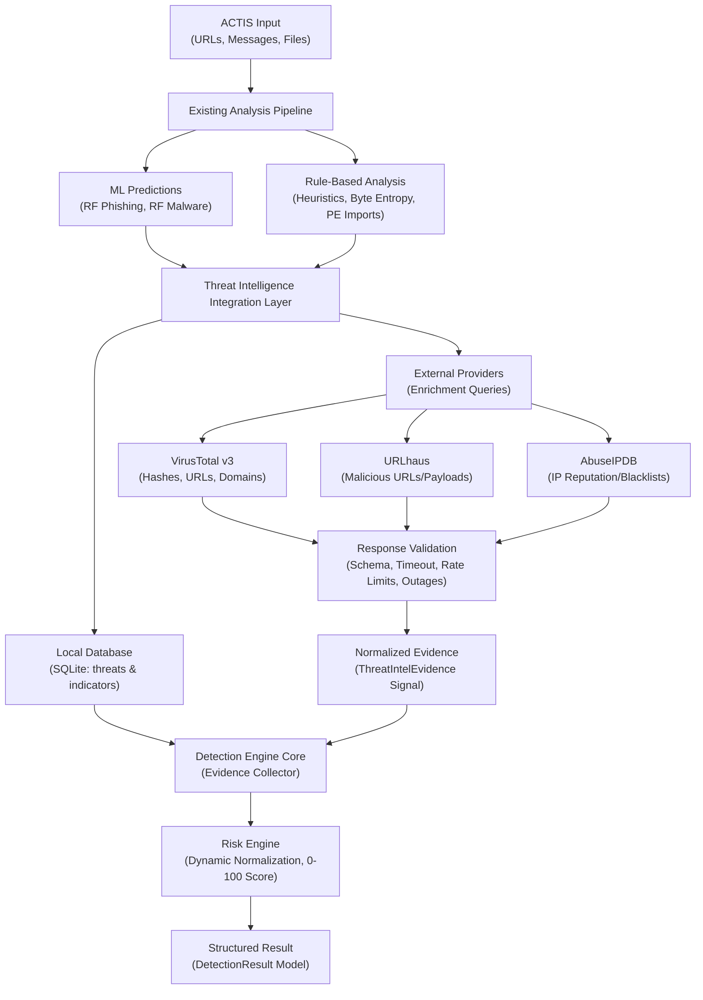
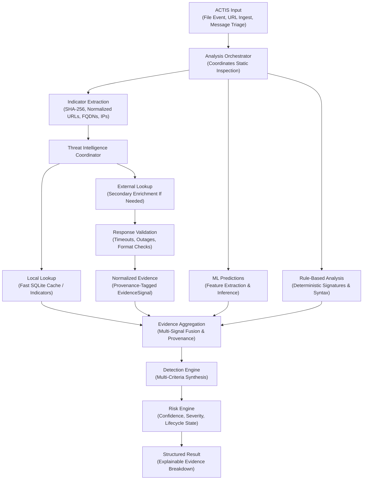

# ACTIS Threat Intelligence Integration Architecture

**Document Type:** Architectural Reference & Integration Specification  
**Document Status:** Architectural Reference / Proposed Integration Design  
**Target Milestone:** Preparation for Day 11 (Online Threat Intelligence)  
**Author:** Aaryan Suman <aaryansuman17@gmail.com>  

---

## 1. Executive Summary & Purpose

This reference document establishes the authoritative architectural blueprint for integrating external and local threat intelligence (TI) into the **ACTIS (Automated Cyber Threat Intelligence System)** unified detection pipeline.

ACTIS operates under a strictly **read-only, local-first, privacy-conscious** model. Threat intelligence is conceived not as an independent, ad-hoc query script, but as **shared analytical infrastructure** that feeds standardized, typed evidence signals into the existing ACTIS Detection Engine and Risk Engine.

> [!IMPORTANT]
> **Status Disclosure:** This document represents the approved target architecture and design specification for threat intelligence integration. It details how external providers (*VirusTotal*, *URLhaus*, *AbuseIPDB*) and local databases interact with the existing analysis orchestrator, ML models, and heuristic rule engines. The presence of a provider or component in these diagrams does **not** signify that it is currently fully operational in code. Implementation statuses are explicitly itemized in the repository component inventory.

---

## 2. High-Level Integration Architecture

The following diagram provides a conceptual view of how threat intelligence integrates into the overarching ACTIS analysis flow:



### Architectural Intent & Scope Boundaries
1. **Conceptual Integration View:** This diagram illustrates the high-level relationship between input processing, analytical layers (ML and rules), intelligence stores, and the decision engine.
2. **Non-Duplication:** Threat intelligence does **not** replace the existing detection engine. External findings are translated into standardized `ThreatIntelEvidence` signals and weighed alongside ML and heuristic evidence.
3. **Provider Status:** Local SQLite lookups are fully verified; external provider connections (VirusTotal prototype; URLhaus and AbuseIPDB planned) are subjected to strict response validation and rate limits before being evaluated by the Risk Engine.

---

## 3. Orchestrator-Based Target Workflow

The detailed operational workflow incorporates the **Analysis Orchestrator**, demonstrating deterministic sequence, local-first evaluation, indicator extraction, and evidence fusion:



### Distinguishing Diagram 1 vs. Diagram 2
- **Diagram 1 (Conceptual Integration View):** A high-level overview establishing where threat intelligence sits relative to static analysis, ML models, and risk scoring.
- **Diagram 2 (Orchestrator Workflow View):** A detailed execution model showing operational reality:
  1. *Early Indicator Extraction:* Normalizes target stimuli into canonical atomic tokens (`sha256`, `url`, `domain`, `ip`) before intelligence lookups occur.
  2. *Local-First Querying:* Local database records are verified first, eliminating unnecessary network latency and preserving API quotas.
  3. *Decoupled Validation & Normalization:* External API responses pass through validation layers before entering evidence aggregation.
  4. *Multi-Criteria Fusion:* ML, Rules, and TI evidence merge into a unified collector (`DetectionEvidence`) handled by the verified ACTIS Decision and Risk Engines.

---

## 4. Component Responsibilities

The planned integration maps directly to well-defined component boundaries:

### A. ACTIS Input
- **Scope:** Ingests raw environmental stimuli from supported input channels:
  - *URLs:* Normalized web links from clipboard, manual entry, or messages.
  - *Messages:* Raw email/chat text parsed for embedded links and social engineering cues.
  - *Files:* User-authorized paths, on-demand device crawl, or real-time filesystem change events (`watchdog`).
- **Constraint:** Does not invoke threat intelligence directly; hands raw input to the orchestrator layer.

### B. Analysis Orchestrator
- **Scope:** Coordinates static inspection, canonical normalization, and dispatch across analytical pipelines.
- **Constraint:** Ensures there is strictly **one canonical analysis path per target type**. Does not re-implement risk scoring or ML inference.

### C. ML Predictions
- **Scope:** Provides statistical threat probabilities derived from trained machine learning models:
  - 19-feature morphological Random Forest phishing model (`models/phishing_model.pkl`).
  - 15-feature static Windows PE Random Forest malware model contract (`models/malware_model.pkl`).
- **Constraint:** Model confidence reflects statistical correlation, **not** definitive ground truth. Must never automatically override verified white-lists or act as the sole determinant of risk.

### D. Rule-Based Analysis
- **Scope:** Evaluates deterministic heuristic rules and domain logic:
  - Suspicious TLDs, IP-based hostnames, excessive subdomains, encoded characters.
  - Windows PE section entropy, known packer sections (`UPX`, `.aspack`), risky import APIs (`VirtualAllocEx`, `WriteProcessMemory`).
- **Constraint:** Emits strongly typed `RuleMatch` objects with assigned severities and rule IDs.

### E. Indicator Extraction
- **Scope:** Identifies and extracts canonical Indicators of Compromise (IoCs):
  - File cryptographic hashes: SHA-256 (primary), MD5, SHA-1.
  - Normalized URLs (lowercase scheme/host, default port removal, boundary cleanup).
  - Fully Qualified Domain Names (FQDNs) and hostnames.
  - Public IP addresses (excluding RFC 1918 private / loopback ranges).
- **Constraint:** Only extracts indicators supported by downstream intelligence contracts.

### F. Local Threat Intelligence
- **Scope:** Fast SQLite lookup against `data/threats.db` (`threats` and `indicators` tables) via WAL mode.
- **Capabilities:** Instant offline lookups, verified indicator confidence scores, and threat status lifecycle tracking (`CONFIRMED`, `SUSPICIOUS`, `CANDIDATE`, `FALSE_POSITIVE`).

### G. External Providers
- **Candidate Providers:**
  - *VirusTotal v3:* Broad multi-engine consensus on hashes, URLs, and domains.
  - *URLhaus:* Real-time tracking of active malicious URLs distributing malware.
  - *AbuseIPDB:* Central reporting and confidence scoring for malicious public IPs.
- **Constraint:** Must be verified for API availability, terms of service, strict rate-limiting compliance, and credential isolation during Day 11. **Zero external API calls are made during Day 10 or architectural documentation tasks.**

### H. Response Validation
- **Scope:** Enforces defensive boundary validation on all provider responses:
  - Handles HTTP status codes (200, 400, 403, 404, 429, 500, 503).
  - Enforces bounded socket timeouts (default 5.0 seconds).
  - Catches malformed JSON payloads and unexpected schema deviations.
  - Manages provider outages gracefully without terminating the application.

### I. Normalized Evidence
- **Scope:** Converts raw provider JSON into canonical typed records (`ThreatIntelEvidence` / `EvidenceSignal`).
- **Preservation:** Retains provider name (`VirusTotal`, `URLhaus`), raw detection counts (`positives`, `total`), query timestamp, and source-specific metrics.

### J. Evidence Aggregation
- **Scope:** Collects signals into `DetectionEvidence` without assuming all providers are equally reliable.
- **Deduplication:** Recognizes when multiple feeds echo the same primary source (provenance checking) to avoid artificial evidence inflation.

### K. Detection Engine
- **Scope:** Central evaluation core (`detection_engine/decision_engine.py`).
- **Constraint:** Collects all heterogeneous evidence signals into a standardized evaluation context. Does not create competing or isolated detection branches.

### L. Risk Engine
- **Scope:** Deterministic mathematical risk scoring engine (`detection_engine/risk_engine.py`).
- **Formula:** Computes normalized 0–100 risk score using dynamic active-weight re-normalization and mutual confirmation boosts across active evidence layers.

### M. Structured Result
- **Scope:** Emits typed `DetectionResult` models containing overall risk score, five-tier risk level, confidence rating, categorical status, and an itemized explainability tree.

---

## 5. Local-First & External Lookup Strategy

To optimize endpoint performance, eliminate redundant network overhead, and strictly maintain privacy boundaries, ACTIS executes threat lookups through an ordered, 9-stage sequence:

```text
1. Validate Indicator       --> Verify syntax, format, hash length, and RFC compliance
2. Canonical Normalization   --> Strip noise, fold casing, remove default ports
3. Local Cache / DB Lookup  --> Fast query against local SQLite indicators
4. Policy Evaluation        --> Evaluate: Is external lookup enabled? Is offline mode active?
5. External Query Dispatch  --> Non-blocking query to configured provider adapters
6. Response Validation      --> Check status, parse JSON, enforce timeouts (≤ 5s)
7. Evidence Normalization   --> Map into ThreatIntelEvidence with provider attribution
8. Signal Provenance Audit  --> Tag source name, raw metrics, and confidence
9. Unified Evidence Fusion  --> Dispatch to Detection Engine & Risk Engine
```

### Deterministic Query Outcome States
Future implementations must distinguish between seven mutually exclusive lookup states:

| Outcome State | Semantic Meaning | Analytical Handling |
|---|---|---|
| **`FOUND_MALICIOUS`** | Known malicious indicator verified by provider or database. | Emits high-severity `EvidenceSignal`; triggers verification evaluation. |
| **`FOUND_BENIGN`** | Known verified safe indicator (e.g. vendor signed, CDN, whitelisted). | Emits benign signal; eligible for `FALSE_POSITIVE` override evaluation. |
| **`NOT_FOUND`** | Indicator is clean/unseen in provider databases. | **Neutral signal.** Absence of intelligence does NOT equal proof of safety. |
| **`PROVIDER_UNAVAILABLE`** | Remote service returned 5xx, connection refused, or DNS error. | Recorded in audit telemetry; dynamic weight normalization redistributes layer weight. |
| **`REQUEST_TIMEOUT`** | Remote provider exceeded bounded timeout threshold. | Non-fatal error; pipeline continues without blocking user. |
| **`INVALID_RESPONSE`** | Malformed response structure, missing schema keys, or HTTP 4xx. | Logged as warning; ignored by evidence scoring to prevent corruption. |
| **`QUERY_SKIPPED`** | External query disabled by offline policy, private IP range, or lack of key. | Documented in audit breakdown; system relies on ML, rules, and local database. |

> [!WARNING]
> **Core Detection Rule:** An unknown indicator (`NOT_FOUND`) must **NEVER** be automatically classified as safe. It simply means external feeds have not yet indexed it; the final verdict must rely on local ML inference and heuristic rule analysis.

---

## 6. Evidence & Risk Semantics

ACTIS maintains strict mathematical and conceptual distinctions between different security metrics. These values must **never** be treated as interchangeable:

```text
┌─────────────────────────────────┐      ┌─────────────────────────────────┐
│     Provider Reputation         │  ≠   │       ACTIS Risk Score          │
│ (e.g. VirusTotal 90/100)        │      │ (Multi-Layer Composite: 0–100)  │
└─────────────────────────────────┘      └─────────────────────────────────┘
                 ≠                                        ≠
┌─────────────────────────────────┐      ┌─────────────────────────────────┐
│      ML Model Probability       │  ≠   │   Categorical Classification    │
│ (e.g. Random Forest 0.94)       │      │ (CONFIRMED, SUSPICIOUS, etc.)   │
└─────────────────────────────────┘      └─────────────────────────────────┘
```

### Clarified Metric Distinctions
1. **ML Prediction ($P_{\text{ML}} \in [0.0, 1.0]$):** Statistical output of a Random Forest classifier evaluating morphological features. Indicates pattern similarity to training samples, not verified malice.
2. **Rule-Based Finding:** Deterministic boolean flag triggered by lexical signatures, packers, or structural anomalies with a fixed severity.
3. **Provider Reputation ($S_{\text{ext}} \in [0.0, 1.0]$):** Ratio of positive detections to total participating scanning engines (e.g., $15 / 72 = 0.21$).
4. **Provider Confidence:** Reliability rating assigned to the reporting service based on historical accuracy and freshness.
5. **Verified Threat-Intelligence Evidence (`ThreatIntelEvidence`):** Typed container encapsulating indicator, verdict, provider provenance, and raw data.
6. **ACTIS-Computed Risk Score ($R \in [0, 100]$):** Composite score calculated by `RiskScoringEngine` using dynamic active-weight normalization:

$$\text{Active Weights Sum} = \sum_{i \in \text{Available}} W_i$$

$$W_i^{\text{normalized}} = \frac{W_i}{\text{Active Weights Sum}}$$

$$\text{Composite Score} = 100 \times \sum_{i \in \text{Available}} \left( S_i \times W_i^{\text{normalized}} \right)$$

7. **Final Detection Classification:** Five-tier categorical lifecycle state:
   - `CONFIRMED`: Multi-engine corroborated threats.
   - `SUSPICIOUS`: High anomaly or high ML score lacking definitive external consensus.
   - `CANDIDATE`: Preliminary unverified flag.
   - `REPORTED`: Incoming unverified telemetry.
   - `FALSE_POSITIVE`: Verified benign software overriding statistical models.

---

## 7. Security, Privacy & Operational Boundaries

All future external threat intelligence integrations must strictly abide by the established ACTIS defensive boundaries:

1. **Credential Isolation:** API keys (e.g. `VIRUSTOTAL_API_KEY`) must **NEVER** be hard-coded into repository files, committed to version control, or printed to log files. All credentials load exclusively from `.env` or system environment variables.
2. **Bounded Network Timeouts:** Every outbound HTTP request must define an explicit timeout (maximum 5.0 seconds). Indefinite network hangs are strictly forbidden.
3. **Rate Limiting & Quota Guards:** Provider client adapters must respect published rate limits (e.g., VirusTotal free tier: 4 requests/minute). Rapid bursts must be throttled or queued.
4. **Zero Full-File Uploads:** **ACTIS NEVER uploads complete user files, documents, or executables to any third-party API or cloud service.** Only cryptographic hashes (SHA-256, MD5) and public URLs/domains may be queried externally.
5. **Private Network IP Shielding:** Local and private IP address ranges (e.g., `127.0.0.1`, `10.0.0.0/8`, `192.168.0.0/16`, `172.16.0.0/12`) are filtered locally and never transmitted to external reputation services.
6. **Preservation of Source Provenance:** Every evidence item must record its source name. External feeds must never be forged or attributed to internal engines.
7. **Graceful Offline Fallback:** If internet connectivity is lost or a provider service is down, ACTIS must continue operating with full analytical fidelity using local models, heuristic rules, and SQLite indicator tables.
8. **Non-Destructive Read-Only Operation:** External threat intelligence findings are purely advisory. They must **never** trigger automatic file deletion, quarantine, process termination, or registry alteration.

---

## 8. Component Implementation Matrix

To maintain absolute architectural transparency, the implementation status of all related subsystems is explicitly categorized:

| Component | Subsystem Location | Realization Status | Verified Baseline / Capabilities |
|---|---|---|---|
| **Local Threat DB** | `reports/threat_database.py` | **IMPLEMENTED** | SQLite WAL mode, relational schema (`threats`, `indicators`), CRUD queries, indexing (Day 4). |
| **Evidence Contract** | `detection_engine/threat_intel_contract.py` | **IMPLEMENTED** | Strongly typed `ThreatIntelEvidence`, `ThreatIntelVerdict`, `IndicatorType`, signal conversion (Day 6). |
| **Detection Decision Engine** | `detection_engine/decision_engine.py` | **IMPLEMENTED** | Multi-criteria evidence fusion, consensus evaluation, explainability tree generation (Day 6). |
| **Risk Scoring Engine** | `detection_engine/risk_engine.py` | **IMPLEMENTED** | Dynamic weight re-normalization ($W_{\text{active}}$), mutual confirmation boost, 0–100 score (Day 6). |
| **URL Scanner Pipeline** | `scanners/url_scanner.py` | **IMPLEMENTED** | 19-feature morphological extraction, RFC validation, session caching (Day 7). |
| **PE Static Extractor** | `scanners/file_feature_extractor.py` | **IMPLEMENTED** | Read-only PE header inspection, 15 static PE features, SHA-256/MD5 hashing, byte entropy (Day 5). |
| **Threat Lookup Wrapper** | `threat_intelligence/threat_lookup.py` | **IMPLEMENTED** | Coordinates local DB query and optional external query handoff. |
| **VirusTotal Client** | `threat_intelligence/api_clients.py` | **PROTOTYPE** | Basic v3 client wrapper exists; rate-limiting, error guards, and validation scheduled for Day 11. |
| **URLhaus Client** | `threat_intelligence/api_clients.py` | **PLANNED** | Not yet implemented in codebase; scheduled for future milestones. |
| **AbuseIPDB Client** | `threat_intelligence/api_clients.py` | **PLANNED** | Not yet implemented in codebase; scheduled for future milestones. |
| **Central Backend TI Sync** | `threat_intelligence/sync_manager.py` | **PROTOTYPE** | Client-server synchronization prototype; production state machine scheduled for Day 12. |

---

## 9. Conclusion & Next Steps

This document serves as the governing architectural specification for Day 11 and beyond. When implementing online threat intelligence:
1. Implement provider client adapters adhering to `BaseThreatClient`.
2. Implement defensive response validation and rate-limit tracking.
3. Map provider outputs to canonical `ThreatIntelEvidence` contracts.
4. Verify integration with `RiskScoringEngine` without altering existing risk formulas.
5. Validate offline fallback and bounded timeouts across automated unit test suites.

