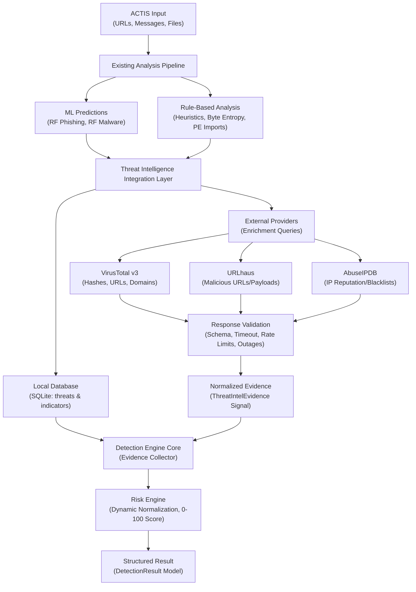
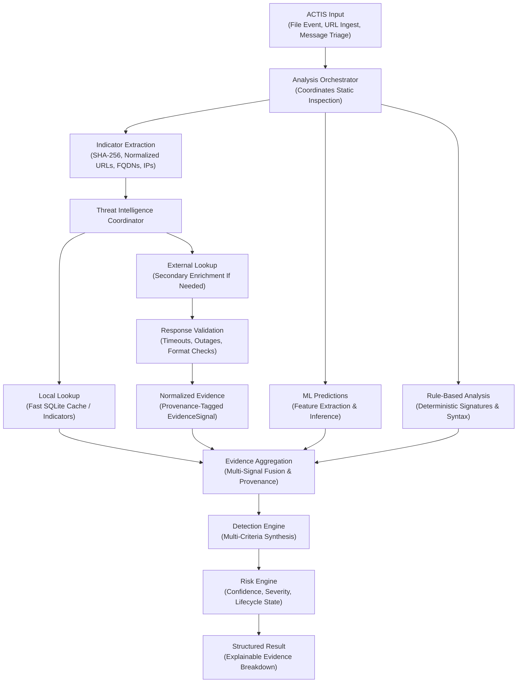

# ACTIS Threat Intelligence Integration Architecture

**Document Type:** Architectural Reference & Integration Specification  
**Document Status:** Architectural Reference / Proposed Integration Design  
**Target Milestone:** Preparation for Day 11 (Online Threat Intelligence)  
**Author:** Aaryan Suman <aaryansuman17@gmail.com>  

---

## 1. Executive Summary & Purpose

This reference document establishes the authoritative architectural blueprint for integrating external and local threat intelligence (TI) into the **ACTIS (Automated Cyber Threat Intelligence System)** unified detection pipeline.

ACTIS operates under a strictly **read-only, local-first, privacy-conscious** model. Threat intelligence is conceived not as an independent, ad-hoc query script, but as **shared analytical infrastructure** that feeds standardized, typed evidence signals into the existing ACTIS Detection Engine and Risk Engine.

> [!IMPORTANT]
> **Status Disclosure:** This document represents the approved target architecture and design specification for threat intelligence integration. It details how external providers (*VirusTotal*, *URLhaus*, *AbuseIPDB*) and local databases interact with the existing analysis orchestrator, ML models, and heuristic rule engines. The presence of a provider or component in these diagrams does **not** signify that it is currently fully operational in code. Implementation statuses are explicitly itemized in the repository component inventory.

---

## 2. High-Level Integration Architecture

The following diagram provides a conceptual view of how threat intelligence integrates into the overarching ACTIS analysis flow:

### Architectural Intent & Scope Boundaries
1. **Conceptual Integration View:** This diagram illustrates the high-level relationship between input processing, analytical layers (ML and rules), intelligence stores, and the decision engine.
2. **Non-Duplication:** Threat intelligence does **not** replace the existing detection engine. External findings are translated into standardized `ThreatIntelEvidence` signals and weighed alongside ML and heuristic evidence.
3. **Provider Status:** Local SQLite lookups are fully verified; external provider connections (VirusTotal prototype; URLhaus and AbuseIPDB planned) are subjected to strict response validation and rate limits before being evaluated by the Risk Engine.

---

## 3. Orchestrator-Based Target Workflow

The detailed operational workflow incorporates the **Analysis Orchestrator**, demonstrating deterministic sequence, local-first evaluation, indicator extraction, and evidence fusion:

### Distinguishing Diagram 1 vs. Diagram 2
- **Diagram 1 (Conceptual Integration View):** A high-level overview establishing where threat intelligence sits relative to static analysis, ML models, and risk scoring.
- **Diagram 2 (Orchestrator Workflow View):** A detailed execution model showing operational reality:
  1. *Early Indicator Extraction:* Normalizes target stimuli into canonical atomic tokens (`sha256`, `url`, `domain`, `ip`) before intelligence lookups occur.
  2. *Local-First Querying:* Local database records are verified first, eliminating unnecessary network latency and preserving API quotas.
  3. *Decoupled Validation & Normalization:* External API responses pass through validation layers before entering evidence aggregation.
  4. *Multi-Criteria Fusion:* ML, Rules, and TI evidence merge into a unified collector (`DetectionEvidence`) handled by the verified ACTIS Decision and Risk Engines.

---

## 4. Component Responsibilities

The planned integration maps directly to well-defined component boundaries:

### A. ACTIS Input
- **Scope:** Ingests raw environmental stimuli from supported input channels:
  - *URLs:* Normalized web links from clipboard, manual entry, or messages.
  - *Messages:* Raw email/chat text parsed for embedded links and social engineering cues.
  - *Files:* User-authorized paths, on-demand device crawl, or real-time filesystem change events (`watchdog`).
- **Constraint:** Does not invoke threat intelligence directly; hands raw input to the orchestrator layer.

### B. Analysis Orchestrator
- **Scope:** Coordinates static inspection, canonical normalization, and dispatch across analytical pipelines.
- **Constraint:** Ensures there is strictly **one canonical analysis path per target type**. Does not re-implement risk scoring or ML inference.

### C. ML Predictions
- **Scope:** Provides statistical threat probabilities derived from trained machine learning models:
  - 19-feature morphological Random Forest phishing model (`models/phishing_model.pkl`).
  - 15-feature static Windows PE Random Forest malware model contract (`models/malware_model.pkl`).
- **Constraint:** Model confidence reflects statistical correlation, **not** definitive ground truth. Must never automatically override verified white-lists or act as the sole determinant of risk.

### D. Rule-Based Analysis
- **Scope:** Evaluates deterministic heuristic rules and domain logic:
  - Suspicious TLDs, IP-based hostnames, excessive subdomains, encoded characters.
  - Windows PE section entropy, known packer sections (`UPX`, `.aspack`), risky import APIs (`VirtualAllocEx`, `WriteProcessMemory`).
- **Constraint:** Emits strongly typed `RuleMatch` objects with assigned severities and rule IDs.

### E. Indicator Extraction
- **Scope:** Identifies and extracts canonical Indicators of Compromise (IoCs):
  - File cryptographic hashes: SHA-256 (primary), MD5, SHA-1.
  - Normalized URLs (lowercase scheme/host, default port removal, boundary cleanup).
  - Fully Qualified Domain Names (FQDNs) and hostnames.
  - Public IP addresses (excluding RFC 1918 private / loopback ranges).
- **Constraint:** Only extracts indicators supported by downstream intelligence contracts.

### F. Local Threat Intelligence
- **Scope:** Fast SQLite lookup against `data/threats.db` (`threats` and `indicators` tables) via WAL mode.
- **Capabilities:** Instant offline lookups, verified indicator confidence scores, and threat status lifecycle tracking (`CONFIRMED`, `SUSPICIOUS`, `CANDIDATE`, `FALSE_POSITIVE`).

### G. External Providers
- **Candidate Providers:**
  - *VirusTotal v3:* Broad multi-engine consensus on hashes, URLs, and domains.
  - *URLhaus:* Real-time tracking of active malicious URLs distributing malware.
  - *AbuseIPDB:* Central reporting and confidence scoring for malicious public IPs.
- **Constraint:** Must be verified for API availability, terms of service, strict rate-limiting compliance, and credential isolation during Day 11. **Zero external API calls are made during Day 10 or architectural documentation tasks.**

### H. Response Validation
- **Scope:** Enforces defensive boundary validation on all provider responses:
  - Handles HTTP status codes (200, 400, 403, 404, 429, 500, 503).
  - Enforces bounded socket timeouts (default 5.0 seconds).
  - Catches malformed JSON payloads and unexpected schema deviations.
  - Manages provider outages gracefully without terminating the application.

### I. Normalized Evidence
- **Scope:** Converts raw provider JSON into canonical typed records (`ThreatIntelEvidence` / `EvidenceSignal`).
- **Preservation:** Retains provider name (`VirusTotal`, `URLhaus`), raw detection counts (`positives`, `total`), query timestamp, and source-specific metrics.

### J. Evidence Aggregation
- **Scope:** Collects signals into `DetectionEvidence` without assuming all providers are equally reliable.
- **Deduplication:** Recognizes when multiple feeds echo the same primary source (provenance checking) to avoid artificial evidence inflation.

### K. Detection Engine
- **Scope:** Central evaluation core (`detection_engine/decision_engine.py`).
- **Constraint:** Collects all heterogeneous evidence signals into a standardized evaluation context. Does not create competing or isolated detection branches.

### L. Risk Engine
- **Scope:** Deterministic mathematical risk scoring engine (`detection_engine/risk_engine.py`).
- **Formula:** Computes normalized 0–100 risk score using dynamic active-weight re-normalization and mutual confirmation boosts across active evidence layers.

### M. Structured Result
- **Scope:** Emits typed `DetectionResult` models containing overall risk score, five-tier risk level, confidence rating, categorical status, and an itemized explainability tree.
