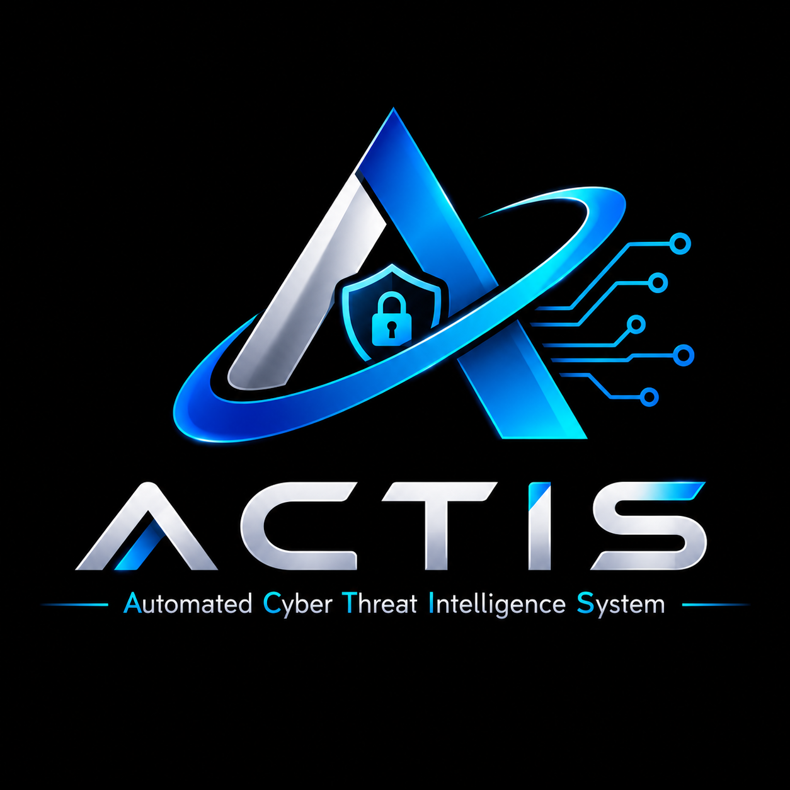

# ACTIS Development Roadmap & Post-Day-7 Evolution

<p align="center">
  
</p>

**Authoritative Roadmap Specification**  
**Milestone:** Post-Day-7 Architectural Evolution  
**Status:** Approved Roadmap Direction  

This directory defines the authoritative development roadmap for **ACTIS — Automated Cyber Threat Intelligence System**.

---

## 1. Roadmap Evolution & Structure

Following the completion of Day 7, ACTIS underwent a major architectural breakthrough: evolving from a collection of isolated scanning tools into a **Windows-oriented, event-driven cyber protection platform**.

The roadmap is strictly structured into three distinct chronological phases:

```text
┌────────────────────────────────────────────────────────────────────────┐
│ COMPLETED: DAYS 1 – 16 (Full Core Foundation & Release Candidate)      │
│ • Architecture, Configuration, Logging, SQLite Database Schemas       │
│ • Machine Learning Contracts & 19-Feature Phishing Random Forest Model │
│ • Static Windows PE Feature Extraction & Safe Binary Parsing           │
│ • Unified Detection Decision Engine & Multi-Criteria Risk Engine       │
│ • URL & Message Scanner Hardening (Deduplication & Single Pipeline)   │
│ • Device Scanner + Incremental Scan State Tracking (Junction Safe)    │
│ • Resident Windows Protection Service Foundation & Worker Pool         │
│ • Event-Driven Filesystem Monitoring (Watchdog + Debouncing Pipeline)  │
│ • External Threat Intelligence (VirusTotal, URLhaus, AbuseIPDB)        │
│ • Scheduled Feed Synchronization Service & Dashboard Controls          │
│ • Central Threat Intelligence REST API (/api/v1) & Secure Feed Sync    │
│ • Grounded AI Security Assistant & Explainable Analysis (Offline)      │
│ • Security Hardening, Adversarial Robustness & Broad Threat Coverage   │
│ • Final Integration, 7-Flow Safe Demo Workflow & Release Acceptance    │
└────────────────────────────────────────────────────────────────────────┘
```

---

## 2. Phase 1: Completed Foundation (Days 1–8)

- **Day 1: Architecture Planning & Repository Foundation** — Repository topology, safe structure validation, and non-destructive policies established.
- **Day 2: Configuration Management** — Strongly typed `AppConfig`, environment variable validation, dynamic project path anchoring (11 passing tests).
- **Day 3: Logging Infrastructure & Audit Trails** — Rotating file handlers, structured JSON log formatting, sensitive credential sanitization.
- **Day 4: Database Contracts & Schema Planning** — SQLite WAL mode persistence for `threats`, `indicators`, `scans`, `detections`, and `scan_items`.
- **Day 5: ML Contracts & Phishing Model Foundation** — 19-feature morphological Random Forest phishing model and metadata contract verification.
- **Day 6: Detection Engine & Risk Engine Integration** — Unified `DetectionDecisionEngine` combining ML, heuristics, and threat intelligence into normalized scores with explainability.
- **Day 7: URL & Message Scanner Hardening** — Boundary-aware link extraction, canonical deduplication, safe heuristics, and strict delegation to the canonical URL analysis pipeline.
- **Day 8: Device Scanner + Incremental Scan State** — Safe recursive filesystem traversal, Windows junction/reparse-point loop safety, safe file metadata extraction, streaming chunked SHA-256 fingerprinting with race detection, incremental scan state tracking (`NEW_FILE`, `UNCHANGED_FILE`, `CHANGED_FILE`, `REMOVED_FILE`, `UNAVAILABLE_FILE`), SQLite persistence (`file_scan_states`), canonical analysis pipeline delegation, and cooperative cancellation.

*Current Baseline Verification:* 162 automated unit and integration tests passing with 100% success rate.

---

## 3. Phase 2: Post-Day-7 Architectural Breakthrough

Introduced after Day 7, this architectural refinement formalizes:
1. **Scanners as Input Providers:** Scanners and sensors feed typed security events into the platform without duplicating detection algorithms.
2. **Analysis Orchestrator:** Canonical analytical pipeline standardizing feature extraction, ML scoring, and heuristic evaluation per target domain.
3. **Resident Protection Service:** Dedicated background service for event intake, write-completion debouncing, and non-blocking job queueing.
4. **Shared Threat Intelligence:** Unified local and remote threat reputation feeds shared across all analysis workflows.

Detailed design is documented in [`docs/architecture/architecture-evolution.md`](../architecture/architecture-evolution.md).

---

## 4. Phase 3: Revised Roadmap Execution (Days 8–16)

### Day 8: Device Scanner + Incremental Scan State (`COMPLETED`)
- **Delivered:** Safe user-authorized filesystem scanning, incremental scan state tracking, privacy-preserving file fingerprints (SHA-256 + mtime/size), junction/reparse-point loop protection, cancellation token support, and skipping unchanged files.
- **Constraint Verified:** Resident Windows Protection Service was NOT implemented today.
- **Components:** `scanners/device_scanner.py`, `scanners/incremental_state.py`, `tests/test_device_scanner.py`, `tests/test_incremental_state.py`.

### Day 9: Windows Protection Service Foundation (`COMPLETED`)
- **Delivered:** Lightweight resident Protection Service foundation, deterministic lifecycle (`start`, `stop`, `pause`, `resume`), state transitions (`STOPPED`, `STARTING`, `RUNNING`, `PAUSED`, `DEGRADED`, `FAILED`), worker pool coordination, bounded failure recovery, canonical `SecurityEvent` schema and validation, thread-safe bounded intake queue (`SecurityEventQueue`), `EventDispatcher` subscription router, decoupled `AnalysisOrchestrationBoundary` handoff, and Windows Service Control Manager host bridge (`WindowsServiceHost`).
- **Constraint Verified:** Real-time filesystem event monitoring (`watchdog` file watcher) was NOT implemented today and remains scheduled for Day 10.
- **Components:** `service/lifecycle.py`, `service/state.py`, `service/workers.py`, `service/events.py`, `service/dispatcher.py`, `service/health.py`, `service/protection_service.py`, `service/windows_host.py`, `tests/test_protection_service_lifecycle.py`, `tests/test_protection_service_workers.py`, `tests/test_protection_service_events.py`.
- **Baseline:** 200 automated unit and integration tests passing with 100% success rate.

### Day 10: Event-Driven File Protection (`COMPLETED`)
- **Delivered:** Real-time Windows filesystem event monitoring (`watchdog` bridge `FilesystemEventSource`), canonical path normalization (`FilesystemEventNormalizer`), temporary and editor swap file filtering (`FileEventFilter`), sliding-window debouncing (`FileEventDebouncer`), bounded event queue (`SecurityEventQueue`) with peak tracking and backpressure, incremental scan state integration (`FileProtectionPipeline`), pre/post-inspection race condition hardening, and direct delegation to the existing `ThreatDetector` static analysis pipeline.
- **Constraint Verified:** Clipboard monitoring, online threat intelligence, notifications, and AI assistant were NOT implemented today.
- **Components:** `scanners/file_watcher.py`, `service/file_normalizer.py`, `service/file_filter.py`, `service/debouncer.py`, `service/file_pipeline.py`, `tests/test_file_protection_events.py`, `tests/test_file_protection_burst.py`, `tests/test_file_protection_integration.py`.
- **Baseline:** 229 automated unit and integration tests passing with 100% success rate.

### Day 11: Online Threat Intelligence (`COMPLETED`)
- **Delivered:** Working external threat-intelligence provider architecture, `BaseThreatClient` abstraction, comprehensive client adapters for VirusTotal v3, URLhaus API v1, and AbuseIPDB API v2 with sliding-window rate limiting and bounded HTTP timeouts. Strict canonical indicator validation (`indicator_validator.py`) with RFC 1918 private IP shielding and URL fragment stripping. Thread-safe in-memory TTL caching (`threat_cache.py`) that strictly avoids caching transient outages or timeouts. Unified 9-stage local-first threat lookup (`threat_lookup.py`) with 8 explicit outcome states (`FOUND_MALICIOUS`, `FOUND_SUSPICIOUS`, `FOUND_BENIGN`, `NOT_FOUND`, `PROVIDER_UNAVAILABLE`, `REQUEST_TIMEOUT`, `INVALID_RESPONSE`, `QUERY_SKIPPED`) and multi-provider conflict resolution. End-to-end integration with the Detection Decision Engine and Risk Engine without altering existing scoring contracts.
- **Constraints Verified:** Zero full-file uploads, API keys masked in logs and representations, no external network dependencies during unit tests (100% mocked transport). Day 12 central intelligence sharing was NOT implemented.
- **Components:** `threat_intelligence/provider_base.py`, `threat_intelligence/api_clients.py`, `threat_intelligence/indicator_validator.py`, `threat_intelligence/threat_cache.py`, `threat_intelligence/threat_lookup.py`, `detection_engine/threat_intel_contract.py`, `tests/test_threat_providers.py`, `tests/test_threat_intel_pipeline.py`.
- **Baseline:** 267 automated unit and integration tests passing with 100% success rate.


### Day 12: Scheduled Threat Intelligence Synchronization & Dashboard (`COMPLETED`)
- **Delivered:** Periodic background sync scheduler (`threat_intelligence/sync/sync_service.py`), lock-safe synchronization lifecycle, feed adapters (`URLhausFeedAdapter`, `AbuseIPDBFeedAdapter`), idempotent database upserts, telemetry tracking, and Streamlit command center sync management integration (`dashboard/app.py`).
- **Constraints Verified:** Local threat scanning remains 100% autonomous; synchronization errors do not impact local file or URL inspections.
- **Components:** `threat_intelligence/sync/sync_service.py`, `threat_intelligence/sync/feed_adapter.py`, `threat_intelligence/sync/threat_database_sync.py`, `dashboard/app.py`, `tests/test_threat_intel_sync.py`.
- **Baseline:** 303 automated unit and integration tests passing with 100% success rate.

### Day 13: Central Threat Intelligence Service & Secure Synchronization (`COMPLETED`)
- **Delivered:** Versioned central FastAPI service (`backend/api.py`), central SQLite persistence (`backend/database.py`), Pydantic v1 schemas with bounded pagination (`backend/models.py`), constant-time HMAC API key authentication, sliding-window rate limiting, anti-poisoning candidate workflow (`CANDIDATE` / `PENDING`), administrative review endpoint (`/api/v1/admin/indicators/{id}/review`), client feed adapter (`CentralACTISFeedAdapter`), and dashboard central service telemetry integration.
- **Constraints Verified:** Local protection engine remains 100% autonomous and offline-functional. Central service is an intelligence exchange channel only; zero remote code execution, zero personal file transmission. Candidate indicators cannot pollute client detection databases without explicit admin review.
- **Components:** `backend/api.py`, `backend/database.py`, `backend/models.py`, `threat_intelligence/sync/feed_adapter.py`, `dashboard/app.py`, `tests/test_central_ti_service.py`.
- **Baseline:** 333 automated unit and integration tests passing with 100% success rate (30 new tests added).

### Day 14: Grounded AI Security Assistant and Explainable Threat Analysis (`COMPLETED`)
- **Delivered:** Read-only security assistant (`assistant/security_assistant.py`), deterministic intent routing (recent detections, explain target, indicator lookup, scan statistics, methodology, safe defensive guidance), multi-factor scoring explainability (Intel 35%, ML 30%, Rules 20%), candidate anti-poisoning caveats, disambiguated target matching, absence-of-evidence safety warnings (missing != safe), secret masking (`mask_sensitive_strings`), provider abstraction (`BaseAssistantProvider`, `DeterministicAssistantProvider`, `ExternalLLMProvider`), dashboard session conversation history (`dashboard/app.py`), and offline indicator badge.
- **Constraints Verified:** Strictly read-only; zero arbitrary OS shell execution, zero automated file deletion/quarantine, zero prompt injection escalation, zero personal file transmission to external LLM providers. Local scanning and intelligence databases remain 100% operational when LLM providers are unavailable.
- **Components:** `assistant/security_assistant.py`, `assistant/__init__.py`, `dashboard/app.py`, `tests/test_security_assistant.py`.
- **Baseline:** 360 automated unit and integration tests passing with 100% success rate (27 new tests added).

### Day 15: Security Hardening, Adversarial Robustness & Broad Threat Coverage Testing (`COMPLETED`)
- **Delivered:** Comprehensive adversarial input hardening across all intake channels (malformed PE headers, truncated files, oversized binaries bounded at 50MB, random noise), malformed and adversarial URL validation, ReDoS-safe linear time message evaluation. Strict privacy safeguards preventing local file paths or document contents from leaking to external intelligence APIs. Automated structured logging credential masking (`SecretMaskingFilter`), special-purpose IP shielding (`is_safe_public_ip` covering RFC 1918, loopback, link-local, unspecified, and multicast), circular-import-safe module boundaries (`detection_engine` / `threat_intelligence`), assistant prompt injection immunity, `SecurityEventQueue` capacity saturation burst stress-testing (500–1,000 events) with backpressure drop telemetry, and isolated SQLite multi-threaded transaction concurrency testing.
- **Constraints Verified:** Strictly read-only; zero dynamic execution of inspected binaries, zero automated file deletion/quarantine, zero unrestricted AI shell execution, zero complete user file uploads.
- **Components:** `tests/test_adversarial_security.py`, `tests/test_privacy_safeguards.py`, `config/config.py`, `detection_engine/threat_detector.py`, `threat_intelligence/indicator_validator.py`.
- **Baseline:** 417 automated unit, integration, and security tests passing with 100% success rate (+57 new tests added).

### Day 16: Final Integration, Demonstration & Release Verification (`COMPLETED`)
- **Delivered:** End-to-end integration audit across all 15 core subsystems, URL parser hardening against illegal path separators and port exceptions, reproducible and deterministic offline demonstration workflow (`scripts/demo_actis.py`) covering 7 representative flows (Demos A–G), isolated database and filesystem sandboxing, and 13 release acceptance tests (`tests/test_release_integration.py`) verifying core analysis entry points, structured result contracts, missing intelligence negative-evidence trap protection, candidate indicator anti-poisoning lifecycle, external provider timeout outcome states, local analysis resilience during central backend outages, sensitive path and private IP shielding, grounded AI assistant explanations, safe malformed binary handling without execution, isolated report generation and cleanup, and demo script execution.
- **Constraints Verified:** 100% offline demonstration by default; zero execution of suspicious binaries, zero automatic file deletion/quarantine, zero mutation of user databases or files during testing/demonstrations, zero upload of user files or documents to external services, and zero unrestricted command execution.
- **Components:** `scripts/demo_actis.py`, `tests/test_release_integration.py`, `scanners/url_scanner.py`, `README.md`, `docs/quickstart.md`, `docs/CHANGELOG.md`.
- **Baseline:** 435 automated unit, integration, adversarial, and release verification tests passing with 100% success rate (+18 new tests added). Milestone Month 1 Release Candidate established.

---

## 5. Authoritative Development Rules

1. **Strict Day-by-Day Sequencing:** Work strictly within the scope of the currently assigned development day.
2. **No Working Ahead:** Do not implement tasks assigned to future days.
3. **Preserve Read-Only Security Boundaries:** Never introduce code execution, automatic file deletion, or covert surveillance.
4. **Atomic Conventional Commits:** Maintain verifiable Git history with verified identity.
